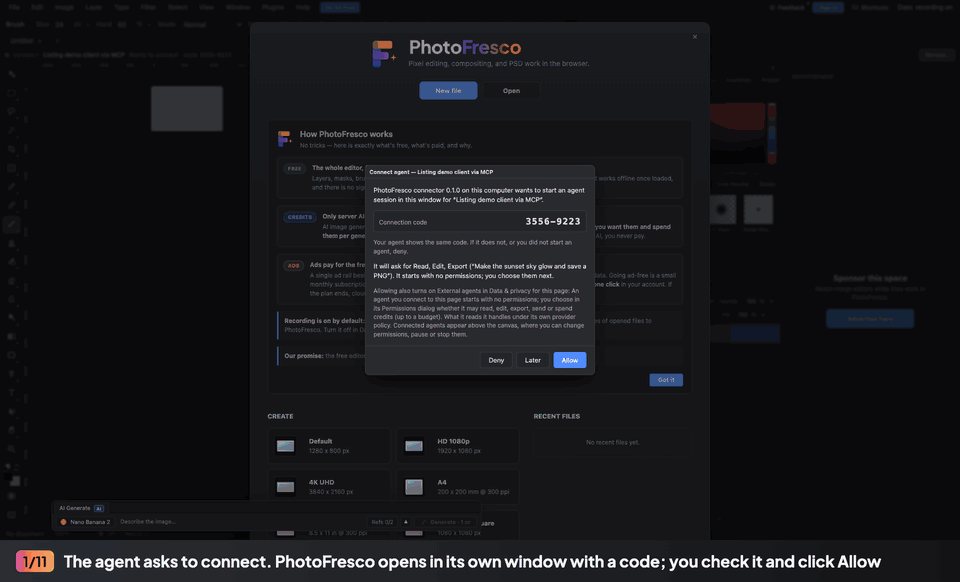

<p align="center"></p>

# PhotoFresco for AI agents

Let AI agents edit images in a PhotoFresco window you approve: layers, masks, previews and export.

[](https://skills.sh/photofresco/photofresco-agent)
[](LICENSE)

[PhotoFresco](https://photofresco.com/?pf_ref=github) is a free, Photoshop-class image editor that
runs in your browser: layers, masks, adjustment layers, selections, brushes, PSD import and
export, and full undo history. This repository connects AI agents to it. An agent (Claude, Cursor,
VS Code, Codex or any MCP client, or a script through the command line) drives a PhotoFresco
window on your own computer. You watch every change, you allow the connection, you choose what the
agent may do, and you can pause or stop it at any time. The editing itself happens in the editor,
so every change lands in its History and can be undone like your own.



The recording above is a real session: an MCP client calling this server against the editor,
captured headless. Category: Design / image editing.

What is in this repository:

- **MCP server** (`photofresco mcp`): one tool per editor operation, previews as images, exports
  as files or resources. Guide: [MCP.md](MCP.md).
- **Agent Skill** ([skills/photofresco](skills/photofresco/SKILL.md)): teaches an agent when and how
  to use PhotoFresco well.
- **Command line** (`photofresco <command>`): open, run saved workflows, export, stop. Guide:
  [CLI.md](CLI.md).
- **Local connector** (the library the other three share): [CONNECTOR.md](CONNECTOR.md).

The editor itself is not in this repository; the connector opens it at photofresco.com.

## Requirements

- Node.js 22 or newer.
- An installed Chromium-based browser: Google Chrome, Microsoft Edge or Chromium 120 or newer.
  Nothing is downloaded. Point `--browser` (or `PHOTOFRESCO_BROWSER`) at another one if needed.
- macOS is verified; Windows and Linux are implemented but not yet verified.

## Configure your agent

Choose the folders the agent may open files from (`--read`) and save exports into (`--write`).
Without them the agent can still edit and preview, but cannot touch your files.

> **npm release pending.** The `photofresco` npm package is published in mid-October 2026, so the
> `npx` commands below do not work yet. Until then, [install the plugin](#install-as-a-plugin)
> or run from a clone of this repository: use `node /path/to/photofresco-agent/src/bin/photofresco.js`
> in place of the `npx -y photofresco` part (no `npm install` needed).

**Claude Code**:

```sh
claude mcp add photofresco -- npx -y photofresco@0.1.0 mcp --read ~/Pictures --write ~/Pictures/PhotoFresco
```

**Claude Desktop**: `claude_desktop_config.json` (Settings → Developer → Edit Config):

```json
{
  "mcpServers": {
    "photofresco": {
      "command": "npx",
      "args": ["-y", "photofresco@0.1.0", "mcp", "--read", "/Users/you/Pictures", "--write", "/Users/you/Pictures/PhotoFresco"]
    }
  }
}
```

**Cursor**: `~/.cursor/mcp.json` (all projects) or `.cursor/mcp.json` (one project), with the same
`mcpServers` entry as Claude Desktop.

**VS Code**: `.vscode/mcp.json` in a workspace, or **MCP: Open User Configuration** for all of
them:

```json
{
  "servers": {
    "photofresco": {
      "type": "stdio",
      "command": "npx",
      "args": ["-y", "photofresco@0.1.0", "mcp", "--read", "/Users/you/Pictures", "--write", "/Users/you/Pictures/PhotoFresco"]
    }
  }
}
```

The server is tested with the official MCP TypeScript client over stdio; these entries follow each
app's documented stdio format. Options:

| Option | Meaning |
|---|---|
| `--read <folder>` | The agent may open image files from this folder (repeatable) |
| `--write <folder>` | The agent may save exports into this folder and new subfolders (repeatable) |
| `--overwrite` | Exports may replace existing files in `--write` folders (the agent must also ask for it) |
| `--tools <groups>` | Which operations are listed as tools: `essentials` (default, at most 40 tools), `all`, or a comma list of groups ([MCP.md](MCP.md)) |
| `--profile <folder>` | Browser profile folder, or `ephemeral` for a throwaway one |
| `--browser <path>` | Chromium-based browser to use (same as `PHOTOFRESCO_BROWSER`) |

### How a session goes

1. The agent calls `photofresco_connect`. PhotoFresco opens in its own window with a **connection
   code**; the agent tells you the same code. Check it and click **Allow**.
2. The session starts with **no permissions**. The agent asks for what it needs (Read, Edit,
   Export; Send and Spend only for cloud and paid AI) and you choose in the **Permissions**
   dialog. Editing tools appear for the agent as you grant them.
3. The agent edits with one tool per editor operation, looks at previews and undoes what it does
   not like. Editing yourself pauses the agent until you press **Resume**. **Stop** ends the
   session; so does closing the window.

Nothing opens until the agent calls `photofresco_connect`: starting the server and listing its
tools starts no browser.

## Install as a plugin

This repository is also a plugin for Claude Code, Codex, Cursor and Gemini CLI: one install adds the
MCP server and the [Agent Skill](#agent-skill). The client copies the repository and starts the server
with `node <plugin folder>/src/bin/photofresco.js mcp`; nothing is downloaded from npm, because the MCP SDK
is bundled readable in [vendor/](vendor/README.md). Node.js 22 or newer must be on your `PATH`.

A plugin install grants **no folders**: the agent edits the image open in the PhotoFresco window, and
you open and save files there yourself. For agent file access, configure the server with `--read` and
`--write` as above instead.

**Claude Code** (in a session; the third line does both steps in one on Claude Code 2.1.275 or later):

```text
/plugin marketplace add photofresco/photofresco-agent
/plugin install photofresco@photofresco
/plugin install photofresco --marketplace photofresco/photofresco-agent
```

**Codex**:

```sh
codex plugin marketplace add photofresco/photofresco-agent
codex plugin add photofresco@photofresco
```

**Gemini CLI**:

```sh
gemini extensions install https://github.com/photofresco/photofresco-agent
```

Gemini CLI passes extensions only a few environment variables, so `PHOTOFRESCO_BROWSER` does not
reach this one; with a browser outside the standard locations, use the MCP configuration above.

**Cursor**: install PhotoFresco from **Customize** once it is listed, or copy this repository into
`~/.cursor/plugins/local/photofresco` and reload the window.

The manifests are `.claude-plugin/` (Claude Code), `plugin.json` with `mcp.json` (the
[Agent Plugins](https://agent-plugins.org) standard, used by Codex), `.cursor-plugin/plugin.json`
(Cursor) and `gemini-extension.json` (Gemini CLI).

## Agent skill

The [Agent Skill](https://agentskills.io/specification) in `skills/photofresco` teaches
skills-capable agents (Claude Code, Codex, Cursor and others) when to use PhotoFresco, how to
connect and ask for permissions, the orient → edit → preview → undo loop, workflows, exports,
every error code and the command line. It does not configure the MCP server; set that up as above.
Install it with the [`skills` CLI](https://github.com/vercel-labs/skills) into the current project
(`-g` for your user):

```sh
npx skills add photofresco/photofresco-agent
```

Remove it with `npx skills remove photofresco`. The operation reference is the server's own tool
list (`photofresco_list_tool_groups`, or `photofresco ops` on the command line).

## Command line

The same package installs a `photofresco` command for scripts and agents that have a shell but no
MCP client. It drives the same kind of approved window through a background connector process.
Until the npm package is published (mid-October 2026), run it from a clone instead of
`npm install -g`: `alias photofresco="node /path/to/photofresco-agent/src/bin/photofresco.js"`.

```sh
npm install -g photofresco@0.1.0
photofresco connect --read ~/Pictures --write ~/Pictures/PhotoFresco
photofresco run warm.json --open ~/Pictures/beach.png --input amount=0.6 \
  --export ~/Pictures/PhotoFresco/beach-warm.png
photofresco stop
```

`connect` opens PhotoFresco and prints a connection code; check that the window shows the same
code, click **Allow** and choose the permissions. `run` opens the image in a new tab, runs a saved
workflow (the portable file the editor's Actions panel exports) and writes the export only after
its SHA-256 matched. `stop` ends the session, closes the window and stops the connector process.

| Command | What it does |
|---|---|
| `connect` | Start the connector if needed, open PhotoFresco and pair (you click Allow) |
| `status` | Connector, window, session, permissions and granted folders |
| `request-access <list>` | Ask for more permissions (`read,edit,export,external-write,spend`) |
| `documents`, `attach <id>` | List open documents; target another one |
| `open <file>` | Open an image from a granted folder in a new tab |
| `run <workflow.json>` | Run a workflow (or `--action <id>`) with `--open`, `--input` and `--export` |
| `export <file>` | Export the document (PNG, PSD or `.pfd`) into a granted folder |
| `exec <op> [params-json]` | Run one editor operation |
| `ops [prefix]`, `describe <op>` | Operations this session may run, and their parameters |
| `outcome <request-id>` | The result of an earlier request after a lost connection |
| `disconnect`, `stop` | End the session; `stop` also closes the window and the connector |
| `mcp` | The MCP server above |

Every command takes `--json` (one object on stdout, also on failure) and returns a documented exit
code (0 success, 2 usage, 3 not connected, 4 path refused, 5 refused by the editor, 8 canceled, 75
still waiting for you). Full reference: [CLI.md](CLI.md).

## What this runs, sends and fetches

Observed on macOS with Chrome for Testing 145 against a local editor build, recorded in
[DISCLOSURE.md](DISCLOSURE.md) with every detail; anything not observed is marked there.

**Runs**

- A Node.js process: the MCP server your client starts (it ends when the client closes it), or
  each `photofresco` command plus one background connector process per data folder (it ends on
  `photofresco stop`, when you close its window, or after a minute with no window or command).
- One browser process tree, only when the agent connects: your installed Chrome, Edge or
  Chromium, started with a **dedicated profile** and its DevTools pipe
  (`--user-data-dir=<profile> --remote-debugging-pipe --no-first-run --no-default-browser-check
  --disable-extensions`). It shows a normal, visible window (the demo above was recorded headless).
  Your everyday browser profiles are never opened, read or attached to.
- No other programs, shell commands, installers, services, login items or extensions.

**Local files and channels**

- Data folder: `~/Library/Application Support/PhotoFresco Connector` (macOS),
  `%LOCALAPPDATA%\PhotoFresco Connector` (Windows) or `~/.local/share/photofresco-connector`
  (Linux). It holds the browser profile (cookies and sign-in if you sign in there, cache, the
  editor's local storage and autosave), a lock file and, for the command line, `cli/` with a Unix
  socket (0600 in a 0700 folder), a per-start random key and `connector.log` (secret-free events:
  granted folder paths, paths, sizes and SHA-256 of files read or written; no keys, file contents
  or pixels; at most 4 MiB).
- Your files: read only inside `--read` folders when the agent opens a file (at most 32 MiB), and
  written only inside `--write` folders when it exports, through a temporary file renamed into
  place after its SHA-256 matched. Existing files are replaced only with `--overwrite` and the
  agent asking for it.
- **No listening network port.** The browser is controlled over its private pipe; the command line
  uses the local socket. Observed: no TCP socket in the server or connector process.

**Network**

- The connector, the MCP server and the command line make no network requests themselves.
  `npx`/`npm install` downloads the package from the npm registry first; a plugin install has the
  agent client copy this repository (from GitHub), and starting the server downloads nothing.
- The browser opens `https://photofresco.com/app/?pf_ref=mcp` (or `cli`), a non-secret tag for
  attribution, and loads the editor like a normal visit. Because the browser is automated, it
  shows no third-party ads.
- **The connector's window starts with session recording off.** The editor recognizes the window
  the connector opened (a private channel no link or website can set up) and starts it with
  nothing allowed in Data & privacy, so **nothing from your files is uploaded**: no session
  recording, no diagnostics, no copy of the files the agent opens and no usage events. Observed:
  no recording or telemetry request from connecting to the end of the session, including after
  the agent imported a photo. Allowing the agent turns on only External agents there.
- Recording stays off **unless you turn recording on in Data & privacy** in that window. From then
  on it sends PhotoFresco the input events, editor commands, document names, typed text
  (password and email fields masked) and **a copy of each image opened in the window**, including
  files the agent opens through the connector (at most 16 MiB each, 6 per page load), plus
  diagnostics (errors, feature events, performance, a device profile) and privacy-safe usage
  events (`referral`, `open`, `edit`, `export`, marked `automated`; no file names or pixels).
  A normal visit to photofresco.com, not opened by the connector, has recording on by default.
- The browser's own background traffic (updates, safe browsing) follows its defaults; not
  measured. Third-party requests of the production site were not verified.

**What the agent receives**

- Only what your grants allow: session status, document state, operation results, **previews
  (pixels)** and exported files. Everything the agent receives goes to that agent's model provider,
  under that provider's policy.
- Paid AI features run only with the Spend permission and the credit budget you set; sending data
  to PhotoFresco services (cloud documents, AI) needs the Send permission.
- The window shows you who is connecting: the name the MCP client sends in its handshake
  ("<name> via MCP"), or `--client` on the command line ("Terminal via CLI" by default).

**You stay in control**: every connection needs your Allow, a session starts with no
permissions, and Stop, closing the window, reloading or leaving the editor ends it. Closing the
connector closes its window.

## Uninstall

Remove the MCP entry from your client configuration (or run `photofresco stop` and
`npm uninstall -g photofresco`), or remove the plugin (`/plugin uninstall photofresco@photofresco` in
Claude Code, `codex plugin remove photofresco@photofresco`, `gemini extensions uninstall photofresco`,
or **Customize** in Cursor). Remove the skill with `npx skills remove photofresco`, and delete the
data folder above. Nothing else is installed.

## Support and license

Questions and bugs: [GitHub issues](https://github.com/photofresco/photofresco-agent/issues) or
hello@photofresco.com. Website: [photofresco.com](https://photofresco.com/?pf_ref=github).

This repository (the MCP server, command line, connector and skill) is released under the
[MIT License](LICENSE). The PhotoFresco editor and the photofresco.com service are not part of it.
